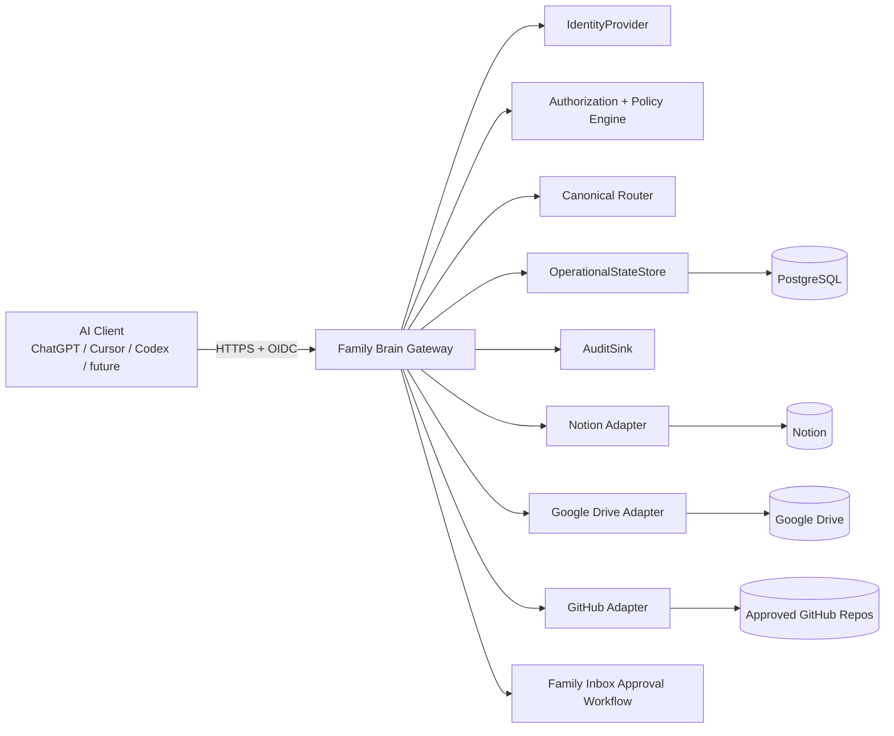

# SIM-G Knowledge Gateway v1 — Engineering Design

> Sanitized design archive. Names and deployment identifiers are fictional. Dates, alternatives and decision states are historical; this document does not grant deployment access or approval. See the decision index for precedence and current limitations.

**Status:** Ready for implementation handoff  
**Date:** 2026-09-03  
**Owner:** Operator  
**Related PRD:** `knowledge_gateway_prd_v1.md`

## 1. Engineering Objective

Build a secure, provider-agnostic gateway that exposes a small semantic Family Brain interface to AI clients while enforcing authentication, authorization, canonical routing, destructive-action policy, auditability, idempotency, provider allowlists, and privacy.

The gateway is deliberately not an AI reasoning service. Conversational models interpret user intent and send normalized metadata. The gateway is the deterministic trusted enforcement and execution layer.

The guiding principle is:

> **Build narrowly in scope, but not narrowly in architecture.**

Implement only the v1 capabilities in the PRD, but isolate cloud, identity, state, audit, and knowledge-provider dependencies behind stable interfaces.

## 2. Recommended Implementation Shape

Use a stateless HTTPS service plus PostgreSQL operational state and provider adapters.

**Owner-approved amendment (2026-10-24), to section 2, with a clarifying note in 18.2.** The Example
production target is one non-Spot Google Compute Engine `e2-micro`.

- **Shape:** it runs the containerized gateway and its operational PostgreSQL,
  which is reachable only over loopback, a Unix socket or an isolated local
  container network. It runs in Google Cloud, independent of the local service host and
  home Internet.
- **Budget:** the complete incremental recurring production cost is strictly
  below USD 10/month, preferably USD 5 or less.
- **Changes:** any other machine type, a managed database or the earlier
  topology needs explicit owner approval.
- **Source:** see `docs/engineering/2026-10-24-e2-micro-hosting-decision.md`.

Sections 18, 19 and 23, `SECURITY.md` and every PRD requirement are unchanged:

- PostgreSQL is never publicly accessible;
- dev and prod stay separate;
- audit, backup and recovery obligations still apply.

The earlier recommendation below, Cloud Run with managed PostgreSQL, is a
non-selected alternative. Its Terraform is preserved on branch
`archive/f13-cloud-run-cloud-sql`.

Earlier recommended initial deployment (superseded for Example production):

- Containerized application service on Google Cloud Run or an equivalent managed container runtime.
- Managed PostgreSQL on Google Cloud for v1 operational state.
- Google OIDC adapter for human authentication.
- Google Cloud Logging implementation of the `AuditSink` interface.
- Dedicated Notion integration.
- Dedicated Google Drive service identity restricted to registered Brain roots.
- Read-only GitHub App restricted to Project Registry-approved repositories.

Core application code must not depend directly on Cloud Run, Cloud SQL, Google Cloud Logging, or other Google-specific implementation details.

## 3. High-Level Architecture



The application service is horizontally scalable and should be stateless between requests. Durable execution state lives in PostgreSQL. Human-facing approval state is represented in the existing Notion Family Inbox and correlated to PostgreSQL by stable operation ID.

## 4. Layer Boundaries

### 4.1 Transport/API Layer

Responsibilities:

- Parse requests.
- Enforce schema validation.
- Invoke authentication middleware.
- Attach request/correlation IDs.
- Convert domain results/errors to stable machine-readable responses.

Must not contain provider-specific business logic.

### 4.2 Identity Layer

Interface concept:

```text
IdentityProvider.verify(token, request_context) -> AuthenticatedIdentity
```

`AuthenticatedIdentity` should contain only normalized claims required by core policy, for example:

```text
principal_id
external_subject
email
issuer
client_id (when available)
authenticated_at
```

The v1 `GoogleOIDCIdentityProvider` validates Google-issued tokens and maps authorized Example Workspace identities to internal principals.

Core code must never accept an identity field supplied by the AI client as authoritative.

### 4.3 Principal and Authorization Layer

Normalize identities to stable Brain principals such as:

```text
operator
steward
participant
```

Authorization is evaluated against:

- principal role
- operation
- target scope
- record ownership/creator
- record age
- sensitivity/content class
- canonical area
- protected flags
- destructive blast radius
- explicit elevation/approval state

Authorization returns a structured decision, not a boolean only:

```text
ALLOW
DENY
APPROVAL_REQUIRED
ELEVATION_REQUIRED
```

Include policy reason codes for audit and client handling.

### 4.4 Semantic Operation Layer

The public client-facing operation surface for v1 is:

```text
search_brain
fetch_record
persist_knowledge
update_record
append_to_record
delete_record
list_approvals
resolve_approval
```

Do not expose raw provider operations through the normal interface.

No `move_record` in v1.

### 4.5 Canonical Router

The AI client supplies normalized semantic metadata. The router applies deterministic policy.

Inputs may include:

```text
subject
domain
record_type
durability
sensitivity
provenance
project_reference
canonical_hint (non-authoritative)
```

Output:

```text
canonical_provider
canonical_container/root
authorized_operation
policy_version
routing_reason
```

If routing cannot be safely resolved, return a structured error:

```json
{
  "code": "insufficient_metadata",
  "missing": ["record_type", "sensitivity"],
  "retryable": true
}
```

or:

```json
{
  "code": "routing_ambiguous",
  "candidates": ["notion", "drive"],
  "required_decision": "Is this the canonical source document or a durable knowledge synthesis?",
  "retryable": true
}
```

No LLM is called by the router.

### 4.6 Provider Adapter Layer

Define a common internal contract where useful, but do not force false symmetry across providers.

Conceptual capabilities:

```text
search(query, scope, limit)
fetch(stable_record_ref)
create(routed_write)
update(stable_record_ref, mutation)
append(stable_record_ref, content)
delete(stable_record_ref)
reconcile(operation_context)
```

GitHub v1 implements search/fetch/reconcile-like read behavior only. Mutation methods should be unsupported by type/capability rather than available and merely hidden.

Provider adapters are responsible for translating provider responses to normalized Brain records and preserving provider identifiers/version references.

## 5. Stable Record References

Every result returned to an AI client should use a normalized stable reference rather than requiring clients to parse provider URLs.

Suggested shape:

```json
{
  "brain_record_id": "brn_...",
  "provider": "notion",
  "provider_record_id": "...",
  "canonical_location": "Family & Household / ...",
  "provider_version": "...",
  "provenance": {...}
}
```

`brain_record_id` may be a gateway-generated stable alias stored in PostgreSQL when necessary. The exact implementation can differ by provider as long as clients receive a stable opaque identifier.

## 6. Unified Search Design

### 6.1 Request

```json
{
  "query": "NAS backup architecture",
  "limit": 10,
  "context": {
    "project": null,
    "intent": "retrieve_context"
  }
}
```

### 6.2 Execution

1. Authenticate principal.
2. Resolve authorized provider/search scopes.
3. Start Notion, Drive, and GitHub searches concurrently.
4. Apply per-provider timeout.
5. Normalize each result.
6. Filter unauthorized records before returning them.
7. Deterministically rank/deduplicate.
8. Return bounded excerpts only.

### 6.3 Response

```json
{
  "results": [
    {
      "brain_record_id": "brn_123",
      "title": "NAS backup architecture",
      "excerpt": "...",
      "provider": "notion",
      "canonical_location": "...",
      "provenance": {...}
    }
  ],
  "completeness": {
    "notion": "complete",
    "drive": "complete",
    "github": "timeout"
  },
  "request_id": "req_..."
}
```

Do not block successful providers on one slow provider beyond the configured timeout.

## 7. Targeted Fetch Design

`fetch_record` takes a stable Brain record ID.

The gateway:

1. Authenticates the caller.
2. Resolves the record and provider.
3. Re-evaluates authorization at fetch time.
4. Retrieves current provider content.
5. Returns normalized content plus provenance/version metadata.

Do not assume authorization granted during an earlier search remains valid indefinitely.

## 8. Write Flow

### 8.1 Generic mutation sequence

For `persist_knowledge`, `update_record`, `append_to_record`, and `delete_record`:

1. Authenticate caller.
2. Validate request schema and idempotency key.
3. Open or load operation record in PostgreSQL.
4. Normalize semantic metadata.
5. Resolve canonical routing where applicable.
6. Evaluate authorization/destructive policy.
7. If approval/elevation is required, persist pending operation state and return structured status.
8. Execute provider operation through service identity.
9. Record provider IDs/version/integrity metadata.
10. Emit audit event.
11. Mark operation terminal state.
12. Return stable result.

### 8.2 Idempotency

PostgreSQL should enforce a unique constraint over the effective idempotency key and operation namespace/principal as appropriate.

On duplicate request ID:

- If terminal: return stored result.
- If in progress: return current operation state or wait only within a short safe bound.
- If outcome unknown: trigger reconciliation rather than blindly rerunning.

### 8.3 Outcome states

Recommended domain states:

```text
RECEIVED
AUTHORIZATION_REQUIRED
APPROVAL_PENDING
EXECUTING
COMPLETED
FAILED
OUTCOME_UNKNOWN
CANCELLED
SUPERSEDED
```

Client-facing states may be simplified to:

```text
completed
failed
approval_required
elevation_required
outcome_unknown
```

## 9. PostgreSQL Operational Model

PostgreSQL is authoritative for machine operational state.

Suggested tables:

### `principals`

- `id`
- `principal_key`
- `display_name`
- `role`
- `status`
- timestamps

### `identity_bindings`

- `id`
- `principal_id`
- `issuer`
- `external_subject`
- `email`
- `enabled`
- timestamps

Unique constraint on `(issuer, external_subject)`.

### `operations`

- `id`
- `request_id`
- `principal_id`
- `client_id`
- `operation_type`
- `state`
- `semantic_metadata` JSONB
- `target_brain_record_id`
- `provider`
- `provider_record_id`
- `provider_version`
- `result_metadata` JSONB
- `error_code`
- `policy_version`
- `created_at`
- `updated_at`

Unique index for idempotency.

### `approval_requests`

- `id`
- `operation_id`
- `family_inbox_record_id`
- `requested_by_principal_id`
- `status`
- `approved_or_declined_by_principal_id`
- `resolution_reason`
- timestamps

No automatic expiry column is required for v1.

### `brain_record_aliases`

Optional if needed for stable opaque gateway IDs:

- `brain_record_id`
- `provider`
- `provider_record_id`
- `canonical_location`
- timestamps

### `policy_versions`

- `version`
- `content_hash`
- `source_governance_ref`
- `activated_at`

Keep actual Brain content out of PostgreSQL except the minimum mutation payload/state required to safely execute pending operations. Sensitive content minimization applies here too.

## 10. Participant Correction Rule

Authorization rule:

```text
Allow immediate delete/replace when:
principal == Participant
AND creator_principal == Participant
AND now - created_at <= 15 minutes
AND scope == authorized Family Shared
AND protected_class == false
```

Otherwise, Participant deletion returns `approval_required`.

Prefer update/replace for wording corrections. Delete remains allowed for accidental or unwanted additions.

Creator and creation time must be available from gateway metadata or provider provenance. The implementation must not trust an AI client to assert ownership or creation time.

## 11. Approval Workflow Engineering

### 11.1 Creating an approval

When policy returns `APPROVAL_REQUIRED`:

- Persist the exact operation request in PostgreSQL.
- Create a safe Family Inbox entry in Notion.
- Store the resulting Family Inbox record ID in PostgreSQL.
- Return `approval_required` with a human-readable message.

The Family Inbox item should include only information safe for Family Shared visibility, for example:

```text
Requested by: Participant
Action: Delete a Family Shared record
Target: [safe title/description]
Request ID: req_...
Status: New
```

Do not put secret, parent-only, or protected payload details into the Family Inbox.

### 11.2 Listing approvals

`list_approvals` is available to Operator and Steward.

It queries authoritative PostgreSQL pending state and may enrich results with Family Inbox display data.

Do not rely on Notion status alone as machine execution truth.

### 11.3 Resolving approvals

`resolve_approval` accepts one pending request and decision.

The gateway must:

1. Authenticate Operator or Steward.
2. Confirm parent/steward authorization.
3. Load exact pending operation from PostgreSQL.
4. Re-fetch/revalidate the target.
5. Re-evaluate current policy.
6. Execute only if still valid.
7. Mark the operation completed/declined/superseded/impossible as appropriate.
8. Update the Family Inbox human-facing status.
9. Emit audit events.

No approval token expiration is used. Requests persist until resolved or invalidated by state change.

## 12. Destructive Action Engineering

Define a blast-radius classifier independent of provider.

Inputs may include:

- number of targets
- operation class
- explicit user intent
- protected flags
- governance/control-plane scope
- migration/rehoming behavior

Examples:

- One explicitly identified ordinary record: routine for Operator/Steward.
- Multiple records or broad selector: elevation required.
- Deletion inferred from a broader instruction: elevation required.
- Governance/security/schema/credential change: Operator control plane only.
- Legal hold/protected record: deny routine delete and invoke protected policy.

Do not infer elevated consent from vague language.

## 13. Policy and Governance Drift

Human-readable governance remains authoritative in the Brain, while executable policy is version-controlled in the gateway repository.

Recommended mechanism:

- Represent executable policy in deterministic configuration/code.
- Store an explicit policy version/hash.
- Maintain references to the canonical governing Notion records or exported governance snapshot.
- Add a validation command/test that compares expected governance identifiers/version markers/hash inputs against executable policy.
- Fail CI or produce a blocking deployment warning when required governance references drift unexpectedly.

Do not make runtime policy dependent on an LLM reading governance on every request.

## 14. Provider Adapters

### 14.1 Notion Adapter

Responsibilities:

- Search only the governed Family Brain scope.
- Fetch pages/database records.
- Create/update/append/delete only after gateway policy authorizes.
- Preserve provider IDs and last-edited/version-like metadata.
- Support Family Inbox creation/update for approval workflow.

The Notion service integration should be scoped narrowly to required Brain content.

### 14.2 Google Drive Adapter

Responsibilities:

- Search only registered Brain roots.
- Never search the caller's whole Drive by default.
- Fetch authorized documents/files and normalized metadata.
- Write only where canonical routing assigns Drive.
- Preserve file IDs, revision/version identifiers where available, and provenance.

Registered roots should be explicit configuration governed by Brain policy.

### 14.3 GitHub Adapter

Responsibilities:

- Read approved Project Registry repositories only.
- Search code/docs/metadata necessary for knowledge retrieval.
- Fetch authorized repository content.
- Reject mutation capability in v1.

Use a read-only GitHub App installation restricted to approved repositories.

## 15. Service Credential and Secret Handling

Define a `SecretProvider` boundary even if the Example deployment initially uses Google Secret Manager.

Rules:

- Secrets are injected at runtime, not committed to source.
- Provider tokens are never logged.
- No API response includes provider credentials.
- Rotation should not require application code changes.
- Dev and prod secrets are separate.
- A compromised provider credential should not automatically expose unrelated providers.

## 16. Audit Architecture

Core logic emits normalized audit events to `AuditSink`.

Example event:

```json
{
  "event_type": "brain.mutation.completed",
  "request_id": "req_123",
  "principal": "operator",
  "client_id": "chatgpt",
  "operation": "update_record",
  "provider": "notion",
  "brain_record_id": "brn_456",
  "provider_record_id": "...",
  "policy_version": "v1.0.0",
  "outcome": "completed",
  "timestamp": "..."
}
```

Do not include full content bodies by default.

Where useful, include content hashes/integrity references and provider versions.

Example implementation: Google Cloud Logging adapter.

Future AWS implementation: CloudWatch adapter or equivalent.

## 17. Error Model

Use stable machine-readable error codes.

Minimum set:

```text
unauthenticated
unauthorized
insufficient_metadata
routing_ambiguous
not_found
provider_unavailable
partial_results
approval_required
elevation_required
protected_record
idempotency_conflict
outcome_unknown
policy_drift
internal_error
```

Responses should distinguish retryable from non-retryable failures.

Do not leak provider secrets, internal stack traces, SQL details, or restricted metadata.

## 18. Networking and Deployment

### 18.1 Public service

The HTTPS gateway endpoint may be publicly routable.

All Brain operations require valid authentication and authorization.

A small unauthenticated health endpoint may exist only if it returns no Brain or sensitive infrastructure information. Prefer separate platform-native health checks where possible.

### 18.2 Database

PostgreSQL must not be publicly internet-accessible.

Use private connectivity from the application runtime to the database.
On the e2-micro target this means a loopback, Unix-socket or isolated local
container connection, with no firewall rule for the database port.

### 18.3 Admin/control plane

Avoid general public admin endpoints in v1.

Administrative configuration should be deployment/configuration/repository driven where practical, with Operator-only authenticated control-plane operations added only when required.

### 18.4 Rate limiting

Implement basic rate limiting and request-size bounds at ingress/application level to reduce abuse and accidental loops.

## 19. Environment Separation

Maintain completely separate dev and prod configuration.

Recommended environment variables/configuration namespaces include:

```text
ENVIRONMENT
DATABASE_URL
OIDC_ISSUER
OIDC_AUDIENCE
NOTION_CREDENTIAL_REF
DRIVE_CREDENTIAL_REF
GITHUB_APP_CREDENTIAL_REF
AUDIT_SINK
POLICY_VERSION
```

Dev provider scopes point only to test/fixture content.

Never allow a dev credential to mutate prod Brain content.

## 20. Performance and Observability

v1 should measure:

- total request latency
- auth latency
- policy/routing latency
- per-provider search latency
- per-provider fetch/mutation latency
- PostgreSQL latency
- timeout counts
- partial-result frequency
- error counts by code
- approval queue age/count

Low-cost v1 optimization:

- parallel provider search
- bounded result counts
- connection pooling/reuse
- short provider timeouts
- no embedded LLM calls
- deterministic local ranking/dedupe where possible
- targeted full fetch only

Do not add vector search, mirrored indexes, or persistent content caches unless v1 measurements justify them for v1.1.

## 21. Suggested Repository Structure

A technology-neutral conceptual layout:

```text
src/
  api/
    routes/
    schemas/
    middleware/
  domain/
    operations/
    authorization/
    routing/
    approvals/
    records/
    errors/
  ports/
    identity_provider
    operational_state_store
    audit_sink
    secret_provider
    knowledge_provider
  adapters/
    identity/google_oidc
    state/postgres
    audit/google_cloud
    secrets/google_secret_manager
    notion/
    drive/
    github/
  config/
    policy/
    provider_roots/
  observability/

tests/
  unit/
  integration/
  contract/
  acceptance/

infra/
  google/
  aws/            # may be absent in v1; interface contract must permit it

docs/
  prd/
  engineering/
  runbooks/
```

Exact language/framework may be chosen during implementation, but keep these boundaries intact.

## 22. Testing Strategy

### 22.1 Unit Tests

Cover:

- routing policy
- principal permissions
- destructive classifier
- Participant correction window
- error mapping
- ranking/deduplication
- policy version handling

Use a controllable clock for time-window tests.

### 22.2 Adapter Contract Tests

Each provider adapter should satisfy explicit contracts for supported capabilities.

GitHub contract tests should prove mutation is unsupported.

Identity, AuditSink, and OperationalStateStore should have common behavioral tests so alternate implementations can be substituted later.

### 22.3 Integration Tests

Use isolated dev fixtures for:

- Notion search/fetch/write
- Drive search/fetch/write
- GitHub search/fetch
- PostgreSQL persistence
- Family Inbox approvals
- OIDC validation where practical

### 22.4 Acceptance Tests

Automate all PRD acceptance criteria, including:

- identity mapping for all three users
- authorization boundaries
- provider allowlists
- Drive root restrictions
- unified search and partial results
- targeted fetch
- canonical write routing
- ambiguous routing retry
- idempotency across restart
- uncertain-outcome reconciliation
- 15-minute creator correction
- protected record override
- durable non-expiring approvals
- either-parent approval
- stale approval revalidation
- broad deletion elevation
- audit emission
- policy drift detection
- dev/prod isolation

### 22.5 Manual Production Readiness

Before prod enablement:

1. Confirm anonymous requests reveal no Brain data.
2. Confirm PostgreSQL has no public exposure.
3. Confirm secrets are not visible in logs/responses.
4. Connect through a real AI-client flow.
5. Search representative knowledge spanning Notion, Drive, and GitHub.
6. Perform safe create/update/delete tests against designated production test records.
7. Validate Family Inbox approval end to end.
8. Validate Participant correction-window behavior with designated test data.
9. Confirm audit events correlate with request IDs.
10. Confirm Operator's daily workflow is usable before enabling Steward and Participant.

## 23. Security Invariants

The implementation must preserve these invariants:

- Provider capability never automatically equals Brain authorization.
- Identity comes from verified OIDC, never from client-declared user metadata.
- No anonymous Brain operations.
- No public PostgreSQL.
- No provider secrets in client responses or logs.
- Participant cannot read outside Family Shared.
- Legal/protected records cannot become deletable due to age/ownership shortcuts.
- Broad destructive actions cannot execute as routine conversational writes.
- GitHub mutation is unavailable through the v1 gateway.
- The gateway contains no autonomous LLM that can override deterministic policy.
- Dev cannot mutate prod.

## 24. Implementation Sequence

Recommended build order:

1. Repository scaffold, configuration model, domain errors, request IDs.
2. PostgreSQL schema and `OperationalStateStore` implementation.
3. Google OIDC adapter and principal mapping.
4. Authorization/destructive policy engine with exhaustive unit tests.
5. Routing metadata contract and deterministic canonical router.
6. AuditSink abstraction and Google Cloud Logging adapter.
7. Notion adapter including Family Inbox workflow.
8. Drive adapter with registered-root enforcement.
9. GitHub read adapter with Project Registry allowlist enforcement.
10. Unified search orchestration and targeted fetch.
11. Mutation/idempotency/reconciliation flows.
12. Approval list/resolve flows.
13. Dev deployment and integration fixtures.
14. Automated acceptance suite.
15. Manual validation and prod deployment.
16. Operator validation, followed by Steward and Participant onboarding.

The implementation agent may refine task granularity, but should not reorder security/policy foundations behind provider mutation work.

## 25. Explicit Deferred Work

Defer to a later design unless v1 evidence makes it necessary:

- `move_record` / cross-provider rehoming.
- Generic customer admin UI.
- AWS deployment module.
- Entra/Okta/Auth0 identity adapters.
- Vector search or embeddings infrastructure.
- Persistent content cache or provider mirror.
- Complex indexing service.
- General GitHub write support.
- Two-parent approval.
- Automated reminder notifications for pending approvals.
- v1.1 performance optimization beyond approved low-cost work.

## 26. Engineering Definition of Done

The engineering build is complete when:

- All interfaces and adapters required by v1 are implemented.
- PostgreSQL operational state and idempotency survive service restart.
- All acceptance tests pass in dev.
- Manual readiness checks pass.
- Production provider credentials and scopes are least-privilege.
- The real AI-client workflow can retrieve and mutate authorized Brain knowledge without raw provider exposure.
- Operator's production workflow works and Steward/Participant onboarding is operationally straightforward.
- The codebase preserves cloud, identity, state, audit, and provider adapter boundaries for future productization.
